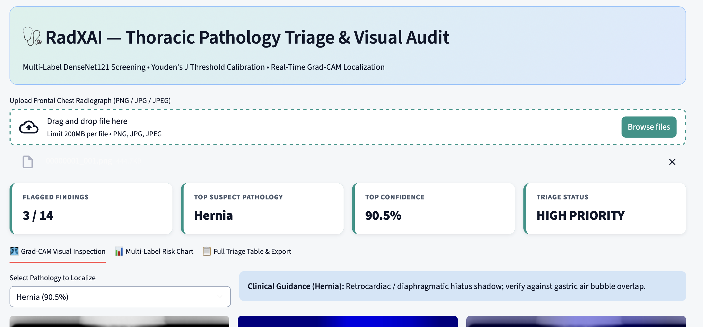
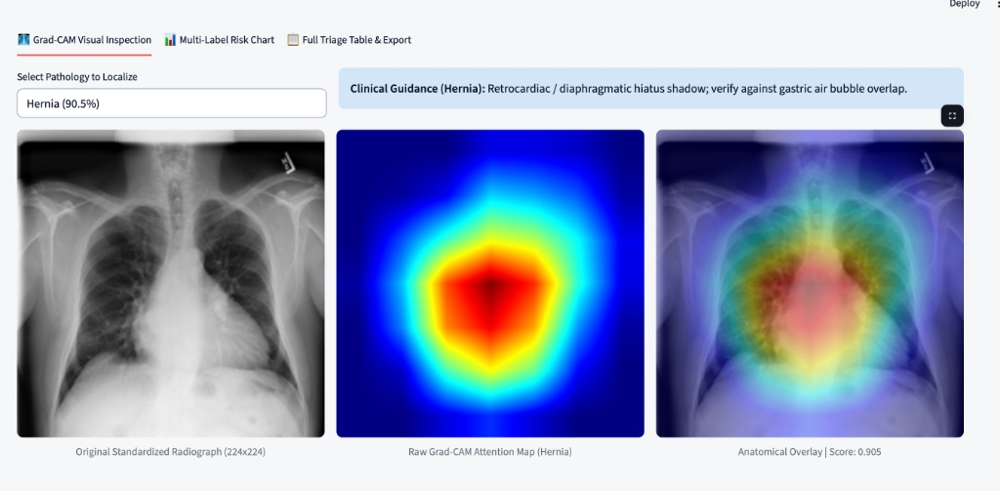

# Chest X-Ray Pathology Detection with Explainable AI (XAI)

Multi-label thoracic pathology classification across 14 diseases on the **NIH ChestX-ray14** dataset using a fine-tuned **DenseNet121** backbone, **patient-isolated splitting**, **Youden's $J$ threshold calibration**, dual **Grad-CAM + SHAP** visual explainability, and an interactive **RadXAI** clinical triage web prototype (`app.py`).

## Pipeline Overview
1. **Streaming Subset Curation:** Quota-balanced sampling from NIH ChestX-ray14 (`250` max per pathology, `500` max `No Finding`) resized to `224x224`.
2. **Multi-Hot Encoding:** 14-dimensional independent binary targets (`[0, ..., 0]` for `No Finding`).
3. **Patient-Isolated Splits:** Two-stage `GroupShuffleSplit` on `patient_id` (70% Train / 15% Val / 15% Test) with zero patient overlap.
4. **Model & Imbalance Loss:** ImageNet-pretrained `DenseNet121` trained with inverse-frequency `BCEWithLogitsLoss(pos_weight)` and FP16 mixed precision.
5. **Explainable AI & Error Auditing:** Spatial localization via **Grad-CAM**, pixel-level attribution via **SHAP (`PartitionExplainer`)**, and high-confidence false-positive shortcut auditing.
6. **Interactive Clinical Triage Prototype (`RadXAI`):** Real-time Streamlit dashboard (`app.py`) supporting frontal X-ray uploads, live Youden's $J$ / custom threshold switching, 3-panel Grad-CAM inspection, and CSV triage report export.

## Interactive Clinical Triage Prototype (`RadXAI`)

| Triage KPI Overview & Controls | 3-Panel Grad-CAM Anatomical Localization |
| :---: | :---: |
|  |  |

### Key Prototype Features (`app.py`)
- **Decision Threshold Mode:** Switch live between *Youden's J Calibrated* ($\tau^*_c$), *Standard 0.50 Cutoff*, and a *Custom Global Cutoff* slider (`0.05`–`0.95`) to inspect sensitivity vs. false-alarm trade-offs.
- **3-Panel Grad-CAM Visual Inspector:** Displays the *Original Standardized Radiograph (`224×224`)*, *Raw Attention Map*, and *Anatomical Overlay* side-by-side with `JET`, `TURBO`, and colorblind-safe `VIRIDIS` palettes, opacity blending slider (`0.10`–`0.80`), and pathology-specific clinical guidance notes.
- **Triage KPIs, Risk Chart & CSV Export:** Displays *Flagged Findings*, *Top Suspect Pathology*, *Top Confidence %*, *Triage Status*, a 14-class probability-vs-threshold bar chart, and one-click downloadable patient triage CSV reports.

### Run the Prototype Locally
```bash
git clone [https://github.com/tharanipothineni-tech/Chest-XRay-Pathology-Detection-XAI.git](https://github.com/tharanipothineni-tech/Chest-XRay-Pathology-Detection-XAI.git)
cd Chest-XRay-Pathology-Detection-XAI

python3 -m venv venv
source venv/bin/activate        # On Windows: venv\Scripts\activate
pip install -r requirements.txt

python3 -m streamlit run app.py
