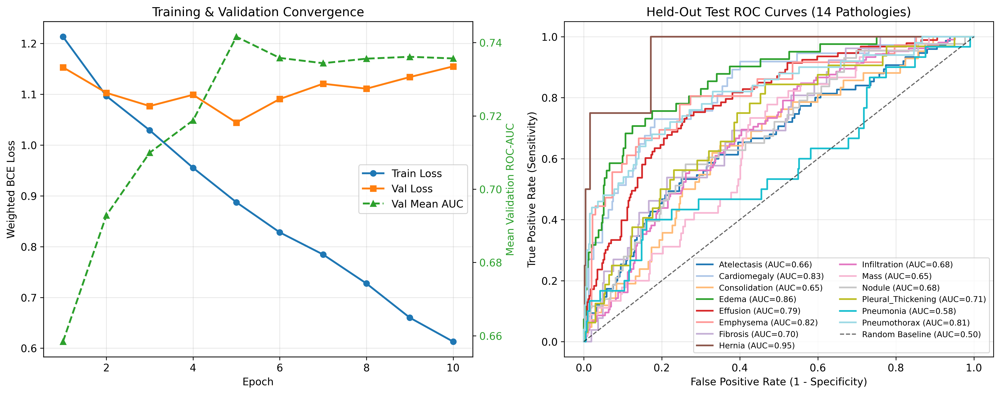
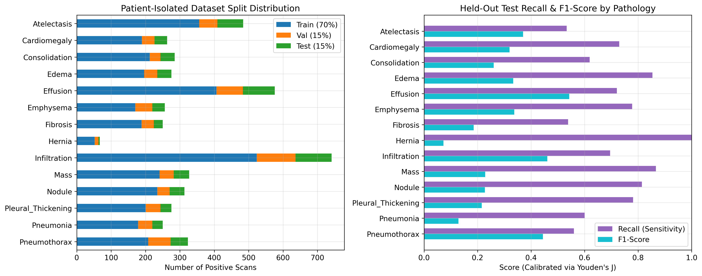
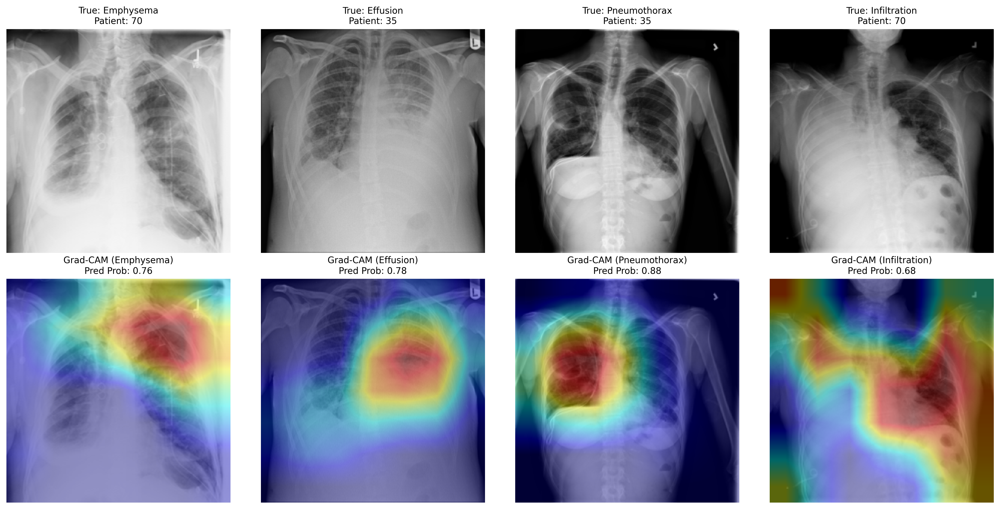
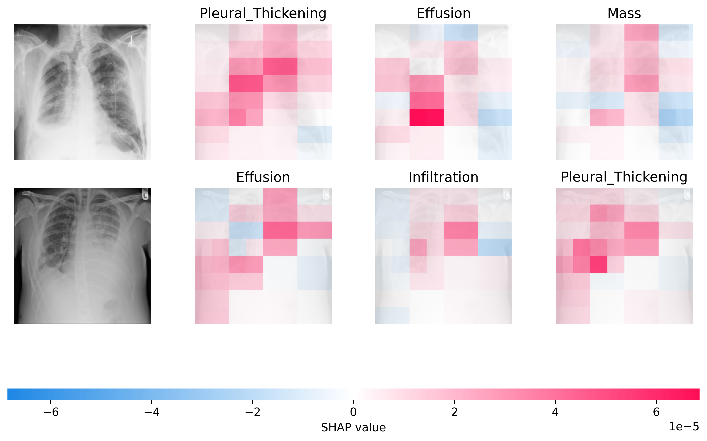
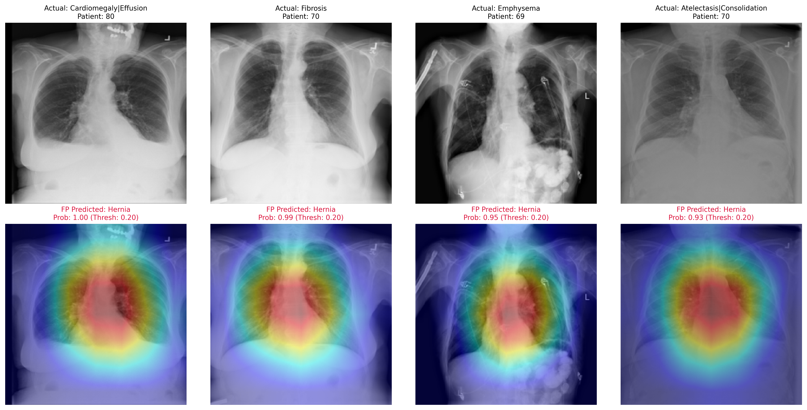
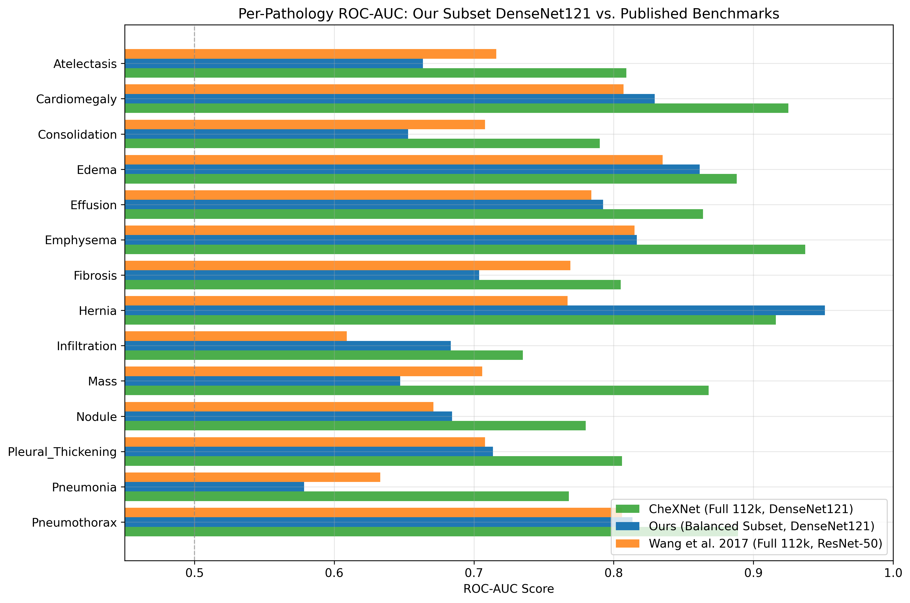

# Chest X-Ray Pathology Detection with Explainable AI (XAI)

Multi-label thoracic pathology classification across 14 diseases on the **NIH ChestX-ray14** dataset using a fine-tuned **DenseNet121** backbone, **patient-isolated splitting**, **Youden's $J$ threshold calibration**, and dual **Grad-CAM + SHAP** visual explainability.

## Pipeline Overview
1. **Streaming Subset Curation:** Quota-balanced sampling from NIH ChestX-ray14 (`250` max per pathology, `500` max `No Finding`) resized to `224x224`.
2. **Multi-Hot Encoding:** 14-dimensional independent binary targets (`[0, ..., 0]` for `No Finding`).
3. **Patient-Isolated Splits:** Two-stage `GroupShuffleSplit` on `patient_id` (70% Train / 15% Val / 15% Test) with zero patient overlap.
4. **Model & Imbalance Loss:** ImageNet-pretrained `DenseNet121` trained with inverse-frequency `BCEWithLogitsLoss(pos_weight)` and FP16 mixed precision.
5. **Explainable AI & Error Auditing:** Spatial localization via **Grad-CAM**, pixel-level attribution via **SHAP (`PartitionExplainer`)**, and high-confidence false-positive shortcut auditing.

## Results & Evaluation Files
Full per-pathology test metrics, false-positive logs, and literature comparisons are included directly in this repository:
* [`test_metrics.csv`](test_metrics.csv) — Per-pathology AUC, F1-Score, Recall, Precision, and Youden's $J$ thresholds.
* [`literature_comparison.csv`](literature_comparison.csv) — Benchmark comparison against Wang et al. (2017) and CheXNet (2017).
* [`false_positives_audit.csv`](false_positives_audit.csv) — High-confidence false-positive error log.
* [`Chest_XRay_Pathology_Detection_XAI.ipynb`](Chest_XRay_Pathology_Detection_XAI.ipynb) — Complete end-to-end Google Colab notebook.

## Visual Results

### Training Convergence & 14-Pathology ROC Curves

### Dataset Split & Per-Class F1 / Recall Summary

### Grad-CAM Anatomical Localization

### SHAP Pixel-Level Attribution

### False-Positive Shortcut Audit

### Published Baseline Comparison (Wang et al. 2017 & CheXNet)

